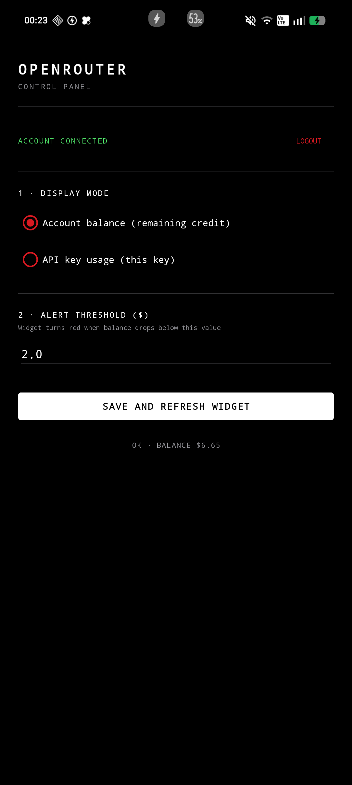
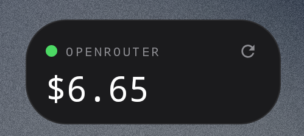
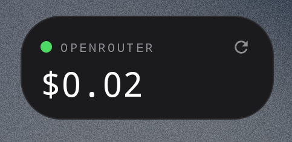

# 📊 OpenRouter Widget

[](https://kotlinlang.org/)
[](https://www.android.com/)
[](https://nothing.tech/)
[](LICENSE)
[](https://rookieenough.github.io/Orion-Data/redirect.html?id=openrouter-widget)


> 📱 Native Android home-screen widget that shows your live OpenRouter credit balance — nothing more, nothing less.

I built this because I was tired of opening a browser tab, logging into OpenRouter, and clicking through to *Settings → Credits* every time I wanted to check how much credit was left before running a prompt. As someone who runs most of my side projects on OpenRouter models, that number matters — and it was living two taps away from my home screen for no reason. Now it lives directly on my **Nothing Phone 2a**, styled to match the Nothing OS design language I already look at fifty times a day.

The app does one thing well: it fetches, caches, and renders your OpenRouter balance in a monospace dot-matrix font inside a pure-black widget. No account system, no analytics, no ads, no subscription. Just a widget and a one-screen configuration activity.

---

## 📸 Preview

| **Configuration** | **Post-Setup** |
|:--:|:--:|
|  |  |
| *Paste your API key to get started* | *Ready to go — display mode, threshold and live balance* |

| **Account Balance Widget** | **Single API Key Widget** |
|:--:|:--:|
|  |  |
| *Remaining credit — green dot while above threshold* | *Cumulative usage of one key — red dot when over budget* |

> Screenshots taken on a Nothing Phone 2a running Nothing OS 3.0 (Android 14).

---

## ✨ Features

- **Two display modes** — show either your total account balance (`total_credits − total_usage`) or the cumulative usage of a single API key
- **Nothing OS aesthetic** — pure black (`#000000`) or dark-grey (`#1B1B1D`) background, thin `1dp` border, `28dp` rounded corners, VT323 dot-matrix numbers, uppercase muted labels
- **Color-coded alert dot** — green when everything is fine, Nothing-red when the balance drops below your custom threshold (or, in key mode, when usage exceeds it)
- **Manual refresh** — tap the refresh icon on the widget to trigger an immediate sync with a live `SYNC...` status indicator
- **Background auto-refresh** — `WorkManager` refreshes every 45 minutes when a network connection is available
- **Error resilience** — if the network is down or the API key is invalid, the widget keeps showing the last known good value with a small red indicator instead of crashing or blanking out
- **Encrypted key storage** — API key persisted via `EncryptedSharedPreferences` backed by the Android Keystore, never logged, never transmitted anywhere except OpenRouter
- **Resizable** — supports 2×1 (compact) and 2×2 (full) layouts, `targetCellWidth="2"` on Android 12+
- **Zero dependencies on heavy frameworks** — classic `RemoteViews` + XML layouts, no Jetpack Glance, no Compose, no navigation library

---

## ⚠️ Known Limitations

These are deliberate scope boundaries and OpenRouter platform constraints, not bugs:

- **Workspace mode is not available on personal accounts** — OpenRouter only exposes the `/workspaces` and `/keys` management endpoints to **Business / Enterprise** plans via a Provisioning API Key. On a personal Free / Standard account (which is what this app was built for), the management key simply does not exist, so workspace-level and per-workspace-key display modes are unreachable. The current release ships with Account and single-key modes only.
- **OAuth "Sign In with OpenRouter" is not supported** — the OpenRouter OAuth flow does not accept custom URI schemes (`openrouterwidget://`) as a `callback_url`, so the browser cannot hand the authorization code back to the app. An earlier iteration of this project implemented full PKCE OAuth and it silently failed at the redirect step — this is an OpenRouter-side limitation, not an app-side bug. The API key is currently pasted manually.
- **No automatic refresh below 30 minutes** — `WorkManager`'s minimum periodic interval is 15 minutes and Android aggressively throttles background work below 30 minutes on most devices. The current 45-minute interval is a battery/accuracy tradeoff. Manual refresh always works instantly.
- **`RemoteViews` is intentionally used instead of Jetpack Glance** — Glance is the "modern" choice for widget UIs, but its compilation stability on AGP 8.5 + Kotlin 1.9 is still rougher than plain `RemoteViews` + XML, especially on OEM skins like Nothing OS. This was a deliberate stability call, not a knowledge gap.
- **Single widget instance assumption** — the app supports multiple widget instances, but they all share the same configuration. There is no per-widget display mode override.

---

## 🛠️ Tech Stack

| Dependency | Version | Notes |
|---|---|---|
| Kotlin | 1.9.24 | |
| Android Gradle Plugin | 8.5.2 | |
| Gradle | 8.7 | |
| `minSdk` | 26 | Android 8.0 — required by `EncryptedSharedPreferences` |
| `targetSdk` / `compileSdk` | 34 | Android 14 |
| `androidx.work:work-runtime-ktx` | 2.9.1 | Periodic background refresh |
| `androidx.security:security-crypto` | 1.1.0-alpha06 | Keystore-backed encrypted preferences |
| OkHttp | 4.12.0 | HTTP client for OpenRouter API |
| kotlinx-coroutines-android | 1.8.1 | Async / suspend functions |
| VT323 | — | Open-source dot-matrix font (SIL OFL), bundled in `res/font/` |
| GitHub Actions | — | CI pipeline that builds the debug APK on every push to `main` |

---

## 🏗️ Architecture

```
┌──────────────────────────────────────────────────────────────┐
│                    MainActivity (config)                     │
│  • Paste API key → validates against /api/v1/credits         │
│  • Choose mode: ACCOUNT or KEY                               │
│  • Set alert threshold ($)                                   │
│  • Saves to EncryptedSharedPreferences                       │
│  • Forces immediate widget refresh via WorkManager           │
└──────────────────────────────────────────────────────────────┘
                              │
                              ▼
┌──────────────────────────────────────────────────────────────┐
│                    RefreshWorker (WorkManager)               │
│  • Runs on network connectivity only                         │
│  • Dispatches to /credits or /key based on displayMode       │
│  • Updates cachedBalance / cachedUsage / cachedLabel         │
│  • Writes result to Prefs, then triggers WidgetUpdater       │
└──────────────────────────────────────────────────────────────┘
                              │
                              ▼
┌──────────────────────────────────────────────────────────────┐
│                    WidgetUpdater (RemoteViews)               │
│  • Reads cached values + threshold + displayMode             │
│  • Formats balance as $X.XX with monospace font              │
│  • Chooses dot color (green vs red) based on mode + threshold│
│  • Wires PendingIntents: tap → MainActivity, icon → refresh  │
└──────────────────────────────────────────────────────────────┘
                              │
                              ▼
┌──────────────────────────────────────────────────────────────┐
│                    OpenRouter API                            │
│  GET /api/v1/credits  → { total_credits, total_usage }       │
│  GET /api/v1/key      → { label, usage, limit, remaining }   │
└──────────────────────────────────────────────────────────────┘
```

### Two display modes, two threshold semantics

The alert threshold has **opposite meanings** depending on the active mode:

| Mode | Value rendered | Threshold means | Red dot when |
|---|---|---|---|
| **ACCOUNT** | Remaining credit (`total_credits − total_usage`) | "Alert me when I'm running low" | `balance < threshold` |
| **KEY** | Cumulative usage of the API key | "Alert me when I've spent too much" | `usage > threshold` |

This inversion is handled in a single `when` block in `WidgetUpdater.update()` — see [`WidgetUpdater.kt`](app/src/main/java/com/nothingwidget/openrouter/widget/WidgetUpdater.kt).

---

## 🧠 Design Decisions

**Why a native widget instead of a Progressive Web App?** A PWA cannot render on the Android home screen as a first-class widget — it can only be added as a browser shortcut, which is a completely different interaction. The whole point of this project is to have the balance visible without opening anything, so a native `AppWidgetProvider` was the only viable path.

**Why `RemoteViews` instead of Jetpack Glance?** Glance is Google's recommended API for widget UIs since 2023, and it does offer a Compose-like DSL that looks nicer on paper. But in practice, on AGP 8.5 + Kotlin 1.9, its `glance-appwidget` compiler plugin still produces opaque errors on OEM skins that alter `RemoteViews` behavior (Nothing OS is one of them). `RemoteViews` + XML layouts is a decade-old, extremely battle-tested API with none of those surprises, and the widget has no state that would benefit from Glance's composability. Stability > novelty.

**Why a manual API key instead of OAuth?** Because OpenRouter's OAuth implementation does not support custom URI schemes for the callback. The full PKCE flow was implemented, tested, and confirmed to dead-end at the redirect step — the browser stays on `openrouter.ai` after login and never hands the authorization code back. This is documented OpenRouter behavior, not an app-side oversight. The manual key path is one extra copy-paste for the user and works 100% of the time.

**Why `EncryptedSharedPreferences` instead of `DataStore`?** `DataStore` is the modern replacement for `SharedPreferences` for general-purpose storage, but as of writing it has no encrypted variant backed by the Android Keystore. `EncryptedSharedPreferences` is deprecated in the Jetpack Security library but remains the only officially supported way to store a secret in Keystore-encrypted form without rolling custom crypto. When Google ships an encrypted `DataStore`, this will migrate.

**Why WorkManager instead of `AlarmManager` or a foreground service?** The widget needs to refresh while the app is closed, on a schedule the OS is willing to honor, without draining battery. `WorkManager` is the only API that combines persistence across reboots, automatic network constraints, doze-mode friendliness, and exponential backoff out of the box. `AlarmManager` would work but is more error-prone; a foreground service would be absurd for a widget that updates twice an hour.

**Why 45 minutes and not 15?** `WorkManager`'s documented minimum periodic interval is 15 minutes, but Android's `JobScheduler` on Nothing OS (and most OEM skins) throttles jobs submitted more frequently than every ~30 minutes when the device is idle. Setting it to 45 minutes guarantees the job actually fires roughly when expected instead of being silently deferred. Users who need fresher data tap the refresh icon — that path always works immediately.

**Why cache the last known value instead of showing an error state?** A widget that shows "ERROR" in red the moment Wi-Fi drops is useless. The app is designed for glanceable information — the last known balance is almost always still relevant, so it's kept on screen with a small red dot in the corner and a `OFFLINE · HH:MM` status line. The value itself only goes blank if the app has *never* fetched successfully.

**Why GitHub Actions instead of local builds?** The development machine is a Windows PC without the Android SDK installed. Instead of requiring a 40-minute Android Studio setup just to produce an APK, the GitHub Actions workflow runs `gradle assembleDebug` on a clean Ubuntu runner and uploads the artifact. Local builds via Android Studio remain fully supported and documented — the CI path is just a convenience.

---

## 📂 Project Structure

```
OpenRouterWidget/
├── .github/
│   └── workflows/
│       └── build-apk.yml              # CI: builds debug APK on every push to main
├── app/
│   ├── build.gradle.kts               # Module config — AGP, Kotlin, dependencies
│   ├── proguard-rules.pro
│   └── src/main/
│       ├── AndroidManifest.xml
│       ├── java/com/nothingwidget/openrouter/
│       │   ├── MainActivity.kt        # Config screen — API key, mode, threshold
│       │   ├── data/
│       │   │   ├── Prefs.kt           # EncryptedSharedPreferences wrapper
│       │   │   └── OpenRouterApi.kt   # OkHttp client + JSON parsing
│       │   ├── widget/
│       │   │   ├── OpenRouterWidgetProvider.kt   # AppWidgetProvider receiver
│       │   │   └── WidgetUpdater.kt              # RemoteViews rendering
│       │   └── work/
│       │       └── RefreshWorker.kt    # WorkManager periodic + manual refresh
│       └── res/
│           ├── drawable/               # Widget background, dots, refresh icon
│           ├── font/
│           │   └── vt323.ttf           # Dot-matrix display font (SIL OFL)
│           ├── layout/
│           │   ├── activity_main.xml
│           │   └── widget_openrouter.xml
│           ├── mipmap-anydpi-v26/
│           │   └── ic_launcher.xml     # Adaptive launcher icon
│           ├── values/
│           │   ├── colors.xml          # Nothing OS palette
│           │   ├── strings.xml
│           │   └── themes.xml
│           └── xml/
│               └── widget_info.xml     # AppWidgetProvider metadata
├── .gitignore
├── build.gradle.kts
├── gradle.properties
├── settings.gradle.kts
└── README.md
```

---

## 🚀 Getting Started

### Prerequisites

- An OpenRouter account with at least one API key — create one at [openrouter.ai/settings/keys](https://openrouter.ai/settings/keys)
- A device running **Android 8.0 (API 26) or later** — the app is designed for Nothing OS 3.0+ but works on any launcher that supports standard `RemoteViews` widgets
- **For installing the APK:** enable *Install unknown apps* for whichever source you use (Telegram, browser, file manager)
- **For building locally:** Android Studio with JDK 17, or the Android SDK + Gradle 8.7 on the command line

### Installation (pre-built APK)

1. Download the latest `app-debug.apk` from the [Actions tab](https://github.com/mirconegri/openrouter-widget/actions) → latest green run → *Artifacts* → `openrouter-widget-debug`
2. Transfer the APK to your phone (Telegram "Saved Messages" is the fastest)
3. Tap the APK → *Install* → authorize the source if prompted
4. Open **OpenRouter Widget** from the app drawer
5. Paste your API key → tap **VERIFICA E SALVA**
6. Set threshold and display mode → **SALVA E AGGIORNA WIDGET**
7. Go to home screen → long-press empty space → *Widgets* → find **OpenRouter** → drag it out

### Building locally

```bash
git clone https://github.com/mirconegri/openrouter-widget.git
cd openrouter-widget
./gradlew assembleDebug
adb install -r app/build/outputs/apk/debug/app-debug.apk
```

On Windows, use `.\gradlew.bat assembleDebug` from PowerShell instead of `./gradlew`. The APK lands at `app/build/outputs/apk/debug/app-debug.apk`.

If you don't have the Android SDK installed, you can skip local builds entirely — the GitHub Actions workflow produces the same APK on every push.

---

## 📖 Usage

### First-time setup

1. **API key** — paste your `sk-or-v1-…` key from OpenRouter. The app validates it by calling `/api/v1/credits`; if the balance shows up in the status line, the key works.
2. **Display mode** — pick one:
   - *Saldo Account (credito residuo)* — widget shows `$credits − $usage`
   - *Uso chiave API (questa key)* — widget shows the cumulative usage of the key you pasted
3. **Threshold** — in *Account* mode this is your "running low" alert level; in *Key* mode it's your "spent too much" alert level
4. Tap **SALVA E AGGIORNA WIDGET**

### Daily use

- **Tap the widget** → opens the config screen
- **Tap the refresh icon** (top-right of the widget) → forces an immediate sync, shows `SYNC...` for a moment
- **Widget turns red** → either your balance dropped below threshold (Account mode) or your key usage exceeded it (Key mode)
- **No interaction needed otherwise** — the widget refreshes itself every 45 minutes

### Changing the API key

Open the app → the *API key* field is pre-filled with your saved key → paste a new one → **VERIFICA E SALVA**. The old key is overwritten in Keystore-encrypted storage.

### Logging out

Tap **LOGOUT** on the config screen. This clears everything in `EncryptedSharedPreferences`, including the cached balance. The widget reverts to `NON CONFIGURATO`.

---

## ⚙️ Configuration

All configuration is stored in `EncryptedSharedPreferences` under the file name `openrouter_secure_prefs`. No `.env` file, no external config, no API keys committed to the repository.

| Key | Type | Default | Description |
|---|---|---|---|
| `user_api_key` | `String` | `""` | OpenRouter API key, encrypted at rest by Keystore |
| `mode` | `String` | `"ACCOUNT"` | Either `"ACCOUNT"` or `"KEY"` |
| `threshold` | `Float` | `2.0f` | Alert threshold in USD |
| `balance` | `Float` | `-1f` | Cached balance (or cached key usage in Key mode) |
| `usage` | `Float` | `-1f` | Cached total usage |
| `label` | `String?` | `null` | Display label under the balance — `"ACCOUNT"` or the key's label |
| `last_update` | `Long` | `0L` | Timestamp of last successful fetch (epoch ms) |
| `last_error` | `String?` | `null` | Last error message, `null` if the last fetch succeeded |

---

## 🗺️ Roadmap

Explicitly planned, not yet implemented:

1. **Per-widget display mode override** — allow different widget instances to show different modes (one for account balance, one for a specific key)
2. **Sparkline history** — keep the last 7 days of balance in a small rolling buffer and render a mini line chart in the widget
3. **Multiple key shortcuts** — store several API keys and let each widget instance bind to one
4. **Nothing Glyph integration** — flash the glyph LEDs red when the balance drops below threshold (needs reverse-engineering, `NothingIntent` API is not publicly documented)
5. **Nothing Playground widget preset** — recreate the visual design as a *Nothing Essentials* widget for users who want the look without installing an APK
6. **Light theme variant** — a white-on-black inverse for users who use Nothing's light mode

---

## 📋 Changelog

| Version | Date | Highlights |
|---|---|---|
| `v2.0.1` | Oct 2026 | Fix inverted threshold semantics in Key mode; remove unused OAuth and workspace code paths |
| `v2.0` | Oct 2026 | Add single-key display mode; refactor for OpenRouter's personal-account API surface |
| `v1.0` | Oct 2026 | Initial release — account balance widget, Nothing OS styling, WorkManager refresh, GitHub Actions CI |

---

## 🤝 Contributing

1. Fork the repository
2. Create a feature branch (`git checkout -b feature/your-feature`)
3. Commit your changes with a clear message
4. Open a Pull Request

For bugs or feature ideas, open an [Issue](https://github.com/mirconegri/openrouter-widget/issues). If you're reporting a widget rendering issue, include your device, Android version, and launcher — `RemoteViews` behavior varies significantly across OEM skins.

---

## 👤 Author & Connect

**Mirco Negri** — *Computer Science Student @ UniTrento*

[](https://mirconegri.com)
[](https://github.com/mirconegri)
[](https://www.linkedin.com/in/mirco-negri-263810225)
[](mailto:mirconegri06@gmail.com)

---

## 📜 License

This project is licensed under the MIT License — see the [LICENSE](LICENSE) file for details.

© 2026 Mirco Negri

